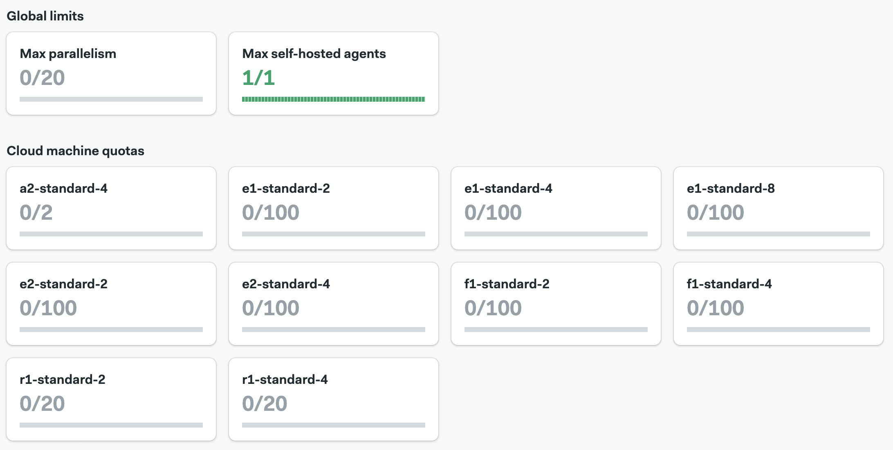

# Quotas and limits

Semaphore applies organization-level quotas to manage the number of machines that can
run at the same time. Quotas help ensure that jobs receive the resources included in your plan.

## Machine quota {#machine-quota}

When all of your organization's machine quota is in use, additional jobs wait in the queue until a
compatible machine becomes available. A job that is waiting for quota has not started running its
commands.

The quota applies to Semaphore Cloud machines and [Self-hosted agents](../using-semaphore/self-hosted).

## Check quota usage {#check-quota-usage}

Use the [Activity Monitor](../using-semaphore/organizations#activity-monitor) to check your
organization's machine quota utilization and the workflows that are currently running or waiting in
the queue:

1. Open the organization menu.
2. Select **Activity Monitor**.
3. Review machine quota utilization and identify the running workflows using the available capacity.

You can also run [`sem get jobs`](./semaphore-cli#sem-get-job) to list running jobs.

## Jobs waiting for quota {#jobs-waiting-for-quota}

If a job is waiting for quota, use the following checks to identify the cause:

1. If the Activity Monitor shows that the machine quota is fully used, the job is waiting for capacity
   within your organization. It starts when a compatible machine becomes available.
2. If the Activity Monitor shows available quota, check the [Semaphore CI Status](https://status.semaphore.io/)
   page for current service updates.
3. If quota is available and the status page reports no service issue, contact Semaphore Support at
   [support@semaphore.io](mailto:support@semaphore.io). Include your organization URL,
   workflow or job URL, selected machine type, and the approximate time that the job began waiting.

## Other limits {#other-limits}

Semaphore also enforces limits for pipelines, blocks, and jobs. For pipeline-level limits, see
[pipeline limits](../using-semaphore/pipelines#limits). For job and block limits, see
[job and block limits](../using-semaphore/jobs#limits).
